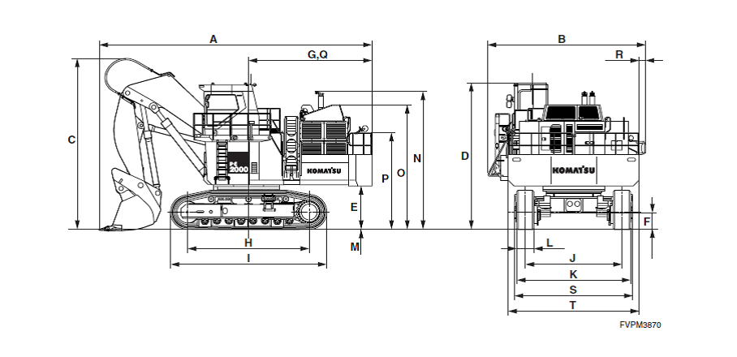
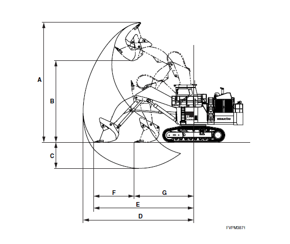
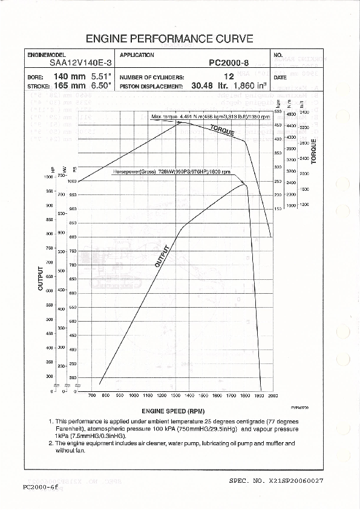
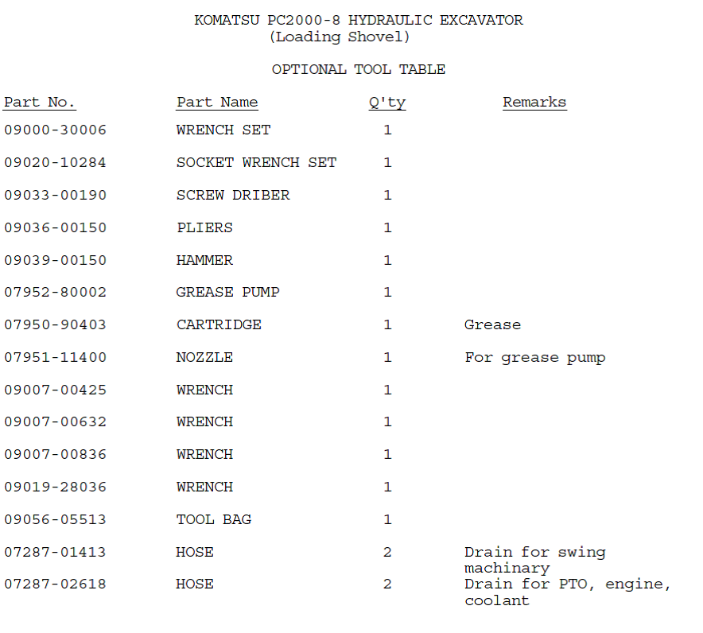
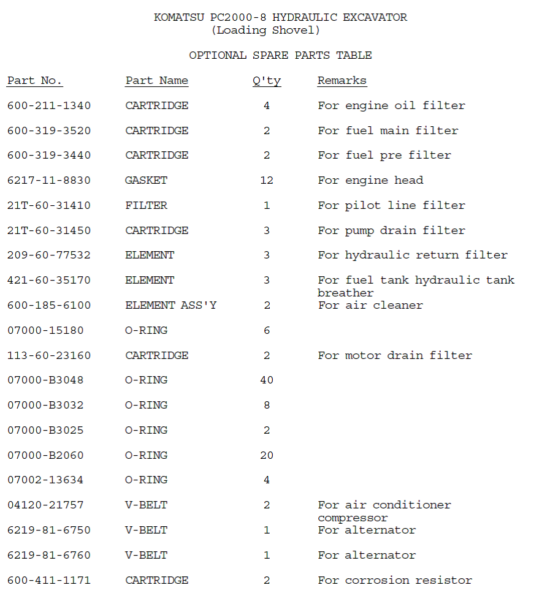

**小松PC2000-8正铲液压挖掘机规格书**

工作重量...............................................……………………..195000 kg

包括润滑油、装满燃油箱、液压油、操作者和

动臂： 5950 mm

斗杆： 4450 mm

铲斗： 堆装 **11.0 m3 (14.4yd3)**

履带板： 810 mm 双齿

飞轮功率：

SAE J1995(GROSS)....................................................728KW(976HP) /1800 rpm

ISO 9249/SAE J1349(NET).........................................713 KW (956HP) /1800 rpm

液压风扇最大转速时的静输出功率…………679KW(910HP)/1800rpm

铲斗容量

堆装............................................................…11.0 m3

铲斗宽度

有側刃……………………………………………….3220mm

动臂长度........................................................……….....5950 mm

斗杆长度.......................................................………......4450 mm

挖掘力：

铲斗挖掘力………....................................……….....721 KN (73500 kgf/162,040lb )

斗杆挖掘力………….................................. . ………755 KN (77000 kgf/169,750ib )

发动机：

生产厂家...........................................................…….株式会社小松制作所

型号.................................................................……...SAA12V140E-3

冷却系统...................................................... …….....水冷

吸气................................................................……....涡轮增压，后冷却式

气缸数...............................................................…….12个

气缸直径........................................................………140 mm

活塞冲程........................................................………165 mm

活塞排量..........................................……… .............30.48 ltr .(1413 cu.in)

性能：

最大扭矩................................................... .4491 N.M (458kgf.m/3,313 IB.FT)

最大扭矩时发动机转速.........................….1350 rpm

燃料系统：

燃料..................................................................柴油

D975-60T NO.2D

燃烧方式..........................................................直接喷射

调速器方式......................................................电子式全程调速

润滑系统:

润滑方式..........................................................压力强制润滑

润滑泵形式......................................................齿轮泵

润滑油滤清器形式..........................................全流式

冷却方式..........................................................水冷和气冷

冷却系统:

冷却器形式…………………………………..离心水泵强制循环

风扇形式..........................................................抽吸式

空气滤清器形式.................................................干式，带自动排尘器

启动系统：

启动方式.........................................................启动马达

马达电压.........................................................24 V

启动功率....................................................... .2X11 KW

发电机电压.....................................................24 V

发电机电流.....................................................2X90A

蓄电池.............................................................4 × 140 Ah/ 12V

液压系统：

形式..............................................................…OLSS（开式负荷感应系统）

可选模式数……………………………………2

主泵：

形式............................................................变量柱塞泵

泵数量.........................................................2个

最大流量.....................................................2317 Ltr./min

风扇驱动泵：

形式................. ................. ................. .......变量柱塞泵

泵数量…………………………………….1个

最大流量…………………………………..324Ltr/min

.

安全阀设定值：

回转液压回路...........................................…………. ..29.4 Mpa(260 kgf/cm2/)

工作装置液压回路...................................……………..29.4 Mpa(320 kgf/cm2)

行走液压回路...........................................…………….. 32.9 Mpa(350 kgf/cm2)

当举重物时……………………………………………..32.9Mpa(350kgf/ cm2)

控制液压回路............................................. ……………2.9 Mpa ( 30 kgf/cm2)

控制阀：

形式/…………………………………………………….. 滑阀式5联阀╳4

液压马达：

行走液压马达............................................…………....轴向柱塞式×2

回转液压马达............................................…………....轴向柱塞式×2

风扇驱动………………………………………………轴向柱塞式×2

油缸数- 缸径Ф×行程×活塞杆直径Ф

动臂 ..........................................................2-280 mm×1930 mm×180 mm

斗杆............................................................2-200 mm×2170 mm×150 mm

铲斗............................................................2-225 mm×2050 mm×160 mm

铲斗卸料.....................................................2-180 mm×600 mm×100 mm

带空调驾驶室：

形式.................................................................................全天候封闭式

工作装置操纵：

形式.................................................................................两肘节式操纵杆

转向控制：

形式.................................................................................两操纵杆和脚踏板

驱动装置：

驱动方式.........................................................................液压驱动

减速系统.........................................................................2级行星齿轮减速

1级正齿轮

最大牵引力.....................................................................1079 kN (110,000 kgf/242,510 lb)

最大行走速度(高).............................................................2.7 km/h (1.7MPH)

爬坡能力........................................................................65 % (33 度)

制动：

行走

操作制动....................................................................液压锁紧

停车制动....................................................................湿式多盘制动器

回转

操作制动....................................................................液压锁紧

保持制动....................................................................湿式多盘制动器

底盘：

形式......................................................................…......履带牵引式底盘

中心架.....................................................................…...H架

履带架..................................................................…......箱形截面结构

履带密封..............................................................……...密封履带

履带调整方式......................................................…......液压式

轮子密封形式.........................................................……浮动油封

履带板：

形式..................................................……................... 二齿

宽度…………………………………………………..810mm

数量............................................ .....……....................49片,每侧

轮子数量：

托轮.........................................……..............................3个每侧

支重轮........................................……...........................8个每侧

接地比压......................................….............................190 kPa (1.94kgf/cm2 )

回转系统：

驱动方式........................................................……….......液压驱动

减速机构........................................................……….......行星齿轮双级减速

回转支撑轴承.................................................………......三排滚动轴承

回转速度........................................................……….......4.8 rpm

工作液体容量(更换量)：

燃油箱……...............................………….........................3400 L

散热器…….................................…………........................180 L

发动机…………................................................…………..120 L

终传动……………….......................................……………85 L每侧

液压系统…………...........................................…………….1300 Ltr

PTO…………………………………………………………..30Ltr

回转驱动……...................................................………….…30 Ltr x2

外观尺寸

5950 mm 动臂

4450 mm 斗杆

A：总长…………………………………………………………………13075 mm

B：总宽…………………………………………………………………7490 mm

C：总高（至动臂顶部）…………………………………………………8180 mm

D：总高（至驾驶室顶部）………………………………………………7030 mm

E：配重离地间隙…………………………………………………………2095 mm

F：最小离地间隙…………………………………………………………825 mm

G：尾部回转半径…………………………………………………………5980 mm

H：履带接地长度…………………………………………………………5780 mm

I：履带长度………………………………………………………………7445 mm

J：履带轨距………………………………………………………………4600 mm

K：履带宽度………………………………………………………………5410 mm

L：履带板宽度……………………………………………………………810 mm

M：履齿高度…………………………………………………………………23 mm

N：到顶部排气管高度………………………………………………… 6605 mm

O: 到驾驶室高度……………………………………………………… 5970 mm

P：到扶手高度,配重…………………………………………………4635 mm

Q：回转中心至后部距离…………………………………………………5880 mm

R:右侧突出侧镜…………………………………………………………310mm

S:底架总宽………………………………………………………………5650mm

T:配重宽度………………………………………………………………6240mm

工作装置:

5950mm (28’7’’)动臂

4450mm (12’10’’)斗杆

A:最大挖掘高度……………………………………………………………14450mm

B:最大卸载高度…………………………………………………………9665mm

C:最大挖掘深度…………………………………………………………3190mm

D:最大挖掘半径……………………………………………………13170mm

E:地面最大挖掘距离…………………………………………………11940mm

F：地面装载距离…………………………………………………………4850

G:装载最近距离…………………………………………………………7090mm

